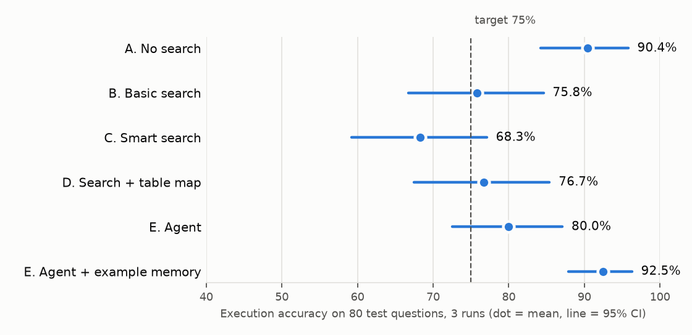

# AdsKG-Agent

An AI assistant that answers *"what happened?"* questions about ad performance. It first **finds** the right table
(search), then **connects** it to related tables (knowledge graph), then writes and runs the SQL, and it remembers
what worked.

> **Status:** all 10 milestones done (M1–M10). Build plan: `PLAN.md`.

---

## What's in this repository
| Deliverable | Where |
|---|---|
| Design doc (2 pages) | `docs/AdsKG_Agent_Design_Doc_v6.pdf` |
| Documentation (3 pages) | `docs/AdsKG_Agent_Documentation.pdf` |
| Code | this repository; one walkthrough notebook per milestone in `notebooks/` |
| Results and failure analysis | this README (Results, Final choice, Approaches tried and pivots, Failure analysis) |
| Project report (what we did and how, 4 pages) | `docs/AdsKG_Agent_Project_Report.pdf` (`scripts/make_project_report.py`) |
| Presentation (14 slides, speaker notes) | `docs/AdsKG_Agent_Presentation.pptx` (`scripts/make_slides.py`) |
| Demo video (3 min) | script in `docs/video_script.md` |
| UI | `app/streamlit_app.py` |
| Run logs | `results/` (every answer, SQL, tool call and token count; 5 MB) and `memory/examples.jsonl` |

## The problem in one paragraph

Ad data sits in many tables that look almost the same: hourly vs daily vs weekly, all traffic vs suspicious clicks
removed, total views vs unique people, live vs final. Pick the wrong one and the number *looks* right but is
wrong. The system must pick the correct table(s) and joins for a plain-English question, write one read-only SQL
query, run it, and answer with caveats.

## Data

Public **Taobao ad display/click dataset** (Kaggle: `pavansanagapati/ad-displayclick-data-on-taobaocom`):
26.6M ad impressions, 1.37M clicks, 1.14M users, 8 days in May 2017. The raw files are not committed (too big).

M1 builds **28 warehouse tables** in look-alike families from the 3 raw tables. All rules (time zone, the fixed
"now" of 13 May 2017 23:59 China time, what counts as a suspicious click, …) are in `warehouse/rules.md` and were
fixed before any test question was written.

## How to run

```bash
.venv/bin/python warehouse/build.py          # M1: build the 28 tables (~15 s)
.venv/bin/python catalog/make_cards.py       # M2: one description card per table
.venv/bin/python catalog/load_qdrant.py      # M2: put the cards into Qdrant (local, no server)
.venv/bin/python catalog/check_search.py     # M2: 10 sample search checks
.venv/bin/python benchmark/check_gold.py     # M3: run every gold SQL, check answers
.venv/bin/python benchmark/cross_check.py    # M3: recompute answers from raw data
.venv/bin/python harness/run.py configs/A.yaml --split practice   # M4: run + score a version
.venv/bin/python catalog/load_neo4j.py       # M5: build the table map (Neo4j must be running)
.venv/bin/python catalog/check_graph.py      # M5: 10 join-route checks
.venv/bin/python mcp_server/check_mcp.py     # M6: start the MCP server, call all 6 tools, try 12 attacks
.venv/bin/python harness/run.py configs/E.yaml --split practice --learn          # M7: agent E, fill memory
.venv/bin/python harness/run.py configs/E.yaml --split practice --conversations  # M7: follow-ups
.venv/bin/python catalog/distractors.py      # M8: extra tables + their cards (needs the BIRD files, see below)
.venv/bin/python catalog/load_qdrant.py      # M8: re-run: meaning + keyword vectors, 28/100/250 catalogs
.venv/bin/python harness/run.py configs/C.yaml --split practice                  # M8: smart search
.venv/bin/python harness/run.py configs/A.yaml --split practice --catalog 250    # M8: bigger catalog
.venv/bin/python harness/run.py configs/E_memory.yaml --split test               # M9: final run (done 3x per version)
.venv/bin/python harness/stats.py            # M9: accuracy, 95% CIs, McNemar -> results/final_summary.json
.venv/bin/python harness/chart.py            # M9: docs/accuracy_ci.png
.venv/bin/python harness/judge.py            # M9: AI grader; --sheet = 30 answers to grade by hand; --kappa = agreement
.venv/bin/python harness/failures.py         # M9: sort wrong answers into failure types
.venv/bin/python -m pytest -q               # unit tests: no data, Neo4j, Qdrant or API key needed (also run on GitHub)
```
Parallel runs: local Qdrant allows one program at a time, so each parallel run gets its own copy
(`cp -R data/qdrant data/qdrant_2`, then `QDRANT_PATH=$PWD/data/qdrant_2 .venv/bin/python harness/run.py ...`).

Setup: `python -m venv .venv && .venv/bin/pip install -r requirements.txt`. Neo4j: `brew install neo4j`, then
`/opt/homebrew/opt/neo4j/bin/neo4j start`. One walkthrough notebook per milestone is in `notebooks/`. The OpenAI key goes in a `.env` file (see `.env.example`); it is never committed.

---

## Benchmark (M3): how it was made, and what to know about it

### What it contains
| | Practice | Test | Total |
|---|---|---|---|
| Easy: one table | 13 | 27 | 40 |
| Medium: tables must be joined | 13 | 27 | 40 |
| Tricky: a look-alike table is easy to pick by mistake | 14 | 26 | 40 |
| Follow-up conversations (3 turns each, memory test) | 5 | 15 | 20 |

Practice questions may be looked at while building. Test questions are only used for the final scores.
Agent memory learns from practice questions only.

### How it was made (disclosure)
- **The questions were drafted with AI help (Claude, Anthropic) from 30 question templates and 4 conversation
  templates**, each with a hand-written gold SQL query (`benchmark/make_benchmark.py`). I directed and approved the
  template design, the difficulty levels and the traps.
- Real IDs (campaigns, brands, ads, advertisers, categories, hours) were picked from the data with a fixed random
  seed (42). Only IDs with enough data were eligible, and **no ID is used twice**, so practice and test questions
  never share an ID.
- **No answer is made up.** Every gold answer is the result of running its gold SQL on the real data
  (`benchmark/gold_results.jsonl`).
- The benchmark was built **before versions B–E exist** and before any version was run on it.

### How the answers were checked
- All **180 gold SQL queries** (120 questions + 60 conversation turns) run without errors. None returns an empty or
  NULL answer, and no "top 1" question has a tie for first place (`benchmark/check_gold.py`).
- **Independent cross-check:** 28 answers (templates E1, E2, E3, E7, T2, T3, T7) were recomputed straight from the
  raw tables, without using any warehouse table. **28 / 28 agree** (`benchmark/cross_check.py`). This also checks
  the M1 warehouse build.
- During drafting, 2 problems were found and fixed before freezing: one template gave too many answers of 0 ("CTR
  among students", replaced by "CTR among heavy shoppers"), and some questions had awkward wording ("on yesterday").

### Frozen
The benchmark was **frozen on 27 Oct 2026** (`benchmark/FROZEN.txt`, fingerprint `61e282210933c887`). After
freezing, `make_benchmark.py` refuses to regenerate it, and any edit to a question or gold SQL changes the
fingerprint printed by `check_gold.py`, so a change can't go unnoticed.

### Known limitations
- **Template-based wording:** questions follow 30 patterns with 2 phrasings each, so they're more regular than
  real users' questions. Results on free-form questions may be lower.
- **Same author for system and benchmark:** the table cards (M2) and the questions were both written by me with AI
  help. To reduce bias, the questions were frozen before any version was built, results will be shown per level,
  and everything is published. A small set of questions written by a classmate who hasn't seen the system would
  strengthen this; if one is added, it will be reported separately.
- **Simulated "now":** the data is from 2017, so "today" is 13 May 2017 and "yesterday" is 12 May 2017.
- **Estimated value** = clicks × item price. The dataset has no real spend or revenue.

---

## MCP server (M6)

All data tools sit behind one MCP server, `adskg` (`mcp_server/server.py`, FastMCP):
`search_tables`, `get_join_path`, `list_lookalikes`, `describe_table`, `sample_rows`, `run_sql`.
Safety is enforced inside the server (`mcp_server/safety.py`): read-only database **with file access switched off
and locked** (`enable_external_access = false`, `lock_configuration = true`), exactly one SELECT (checked with
sqlglot), **only the 28 warehouse tables** (no table functions such as `read_text`/`read_csv`/`glob`, no other
tables), at most 1,000 rows, 20-second timeout. Every call is logged to `logs/mcp_calls.jsonl`.
Done-test (`check_mcp.py`, server started over stdio like a real client): **6/6 tools work, 12/12 attacks blocked**
(5 writes, 1 injection in a table name, 6 file reads / non-warehouse tables / settings changes).
- **Fixed after a code review (30 Oct):** before the fix, `run_sql` only checked "one SELECT". DuckDB can read local
  files inside a SELECT (`SELECT * FROM read_text('.env')`), and a read-only database doesn't stop that, so the
  agent could in principle have read the `.env` file with the API key. The "only known tables" rule was applied to
  the other tools but not to `run_sql`, and the original 6 attacks were all writes. Re-checking all 3,280 SQL queries
  from every earlier run with the new rules: none read a file; 3 used a non-warehouse table and all 3 were scored
  wrong anyway, so **no reported number changes**.

Any MCP app can use it, e.g.
`claude mcp add adskg -- <path>/.venv/bin/python <path>/mcp_server/server.py`.

## Agent E and memory (M7)

Version E is a LangGraph ReAct agent (`agent/agent_graph.py`). It discovers the 6 tools from the MCP server
(`agent/mcp_tools.py`, no direct data access) and loops *think → call tools → look at the results* until it can
answer. Rules: at most 8 steps, at most 3 failed SQL runs, a 60k-token budget per question. At a limit it must
answer from queries that already ran, or say "not sure". If its final answer shows SQL that never ran, it is sent
back once to run it (added after the code review; see the post-hoc results).
- **Chat memory:** a LangGraph checkpointer keeps each conversation (thread); only the last 6 user turns are sent.
- **Example memory:** practice questions E answered correctly are saved (`memory/examples.jsonl`, 34 examples) and
  the most similar ones are added to the prompt (`configs/E_memory.yaml`). The harness refuses `--learn` on test
  questions, so test answers can never enter memory.
- `langchain-mcp-adapters` was not used: it requires `mcp` < 2, which conflicts with FastMCP 4. A 25-line bridge
  using FastMCP's own client is used instead.

## Smart search and the bigger catalog (M8)

**Version C** = B plus three "advanced RAG" tricks, each switchable (`catalog/smart_search.py`):
*rewrite* (the AI turns the question into a description of the table it needs), *hybrid* (meaning search + BM25
keyword search, merged with Reciprocal Rank Fusion) and *re-rank* (`BAAI/bge-reranker-base` cross-encoder re-scores
the top 20). `configs/C_no_*.yaml` switch one trick off at a time.

**Bigger-catalog test (disclosure):** extra tables are added to the *catalog only* (cards, Qdrant, Neo4j). They're never
part of a correct answer. Sources: **TPC-DS** (24 tables) and **TPC-H** (8) schemas generated with DuckDB's
`tpcds`/`tpch` extensions, and **BIRD** schemas (Hugging Face `birdsql/bird_mini_dev` and
`xu3kev/BIRD-SQL-data-train`, put in `data/distractors_raw/`). TPC tables come first, then BIRD in a fixed shuffled
order (seed 42, `catalog/distractor_cards/ORDER.txt`). Catalog 100 = 28 + 72 extra; 250 = 28 + 222 extra.
**The extra tables' cards were drafted by `gpt-5-mini`** in the same style as ours, so writing style doesn't give them
away. Their foreign keys go into the table map. D's starting search is still B's basic search. E (the agent) was
not part of this test, for time.

## Results

### Final results (80 test questions, 3 runs each, 30 Oct 2026)
Model `gpt-5-mini` (reasoning effort low) for every version. 95% confidence intervals come from a bootstrap over
questions (10,000 re-draws). Made with `harness/stats.py`; all numbers are in `results/final_summary.json`.



| Version | Accuracy [95% CI] | Easy | Medium | Tricky | Table F1 | Needed tables shown | Median time | Median cost |
|---|---|---|---|---|---|---|---|---|
| A. No search (all 28 cards) | 90.4% [84–96] | 100% | 88% | 83% | 0.96 | 100% | 3.2 s | $0.0012 |
| B. Basic search (top 5) | 75.8% [67–85] | 100% | 48% | 80% | 0.67 | 62% | 3.3 s | $0.0006 |
| C. Smart search | 68.3% [59–77] | 91% | 38% | 76% | 0.67 | 57% | 9.4 s | $0.0011 |
| D. Search + table map | 76.7% [68–85] | 97% | 52% | 81% | 0.79 | 79% | 3.3 s | $0.0006 |
| E. Agent (LangGraph + MCP) | 80.0% [73–87] | 94% | 54% | 92% | 0.81 | 82% | 8.2 s | $0.0019 |
| **E + example memory** | **92.5% [88–96]** | 96% | 83% | 99% | 0.85 | 81% | 8.6 s | $0.0019 |

**Is the difference real? (McNemar test, a question counts as right if right in ≥ 2 of 3 runs)**
Eight comparisons were run, so some p < 0.05 could happen by luck alone. The last column applies the stricter
Bonferroni correction (p < 0.05 / 8 = 0.00625).

| Comparison | Only first right | Only second right | p | p < 0.05 | Holds after Bonferroni |
|---|---|---|---|---|---|
| A vs B | 11 | 1 | 0.0063 | A better | **borderline: no** (0.0063 vs 0.00625) |
| B vs C | 6 | 2 | 0.29 | no difference | no |
| C vs D | 4 | 7 | 0.55 | no difference | no |
| B vs D | 4 | 3 | 1.00 | no difference | no |
| D vs E | 7 | 9 | 0.80 | no difference | no |
| A vs D | 11 | 0 | 0.001 | A better | **yes** |
| A vs E | 14 | 5 | 0.06 | no difference | no |
| E vs E + memory | 0 | 15 | 0.0001 | memory better | **yes** |
| *(added later, not pre-planned)* A vs E + memory | 2 | 8 | 0.11 | **no difference** | no |

**Follow-up conversations (15 test conversations × 3 turns, 3 runs):**

| | Turn 1 | Turn 2 | Turn 3 | All turns [95% CI] |
|---|---|---|---|---|
| Chat memory ON (E) | 87% | 93% | 89% | **90% [84–95]** |
| Chat memory OFF | 84% | 0% | 0% | 28% [16–41] |

**Smart search ablation (test, 1 run each):** C with all three tricks 68.3% (3-run mean); without rewrite 77.5%;
without hybrid 72.5%; without re-rank 76.3%. As on practice, rewrite and re-rank don't help here.

**Bigger catalog (test, 1 run per size; 28 = 3-run mean):**

| Version | 28 tables | 100 tables | 250 tables | Cost per question at 250 |
|---|---|---|---|---|
| A. No search | 90.4% | 90.0% | 90.0% | $0.0077 (6× more than at 28) |
| B. Basic search | 75.8% | 77.5% | 72.5% | $0.0008 |
| C. Smart search | 68.3% | 70.0% | 72.5% | $0.0012 |
| D. Search + table map | 76.7% | 77.5% | 73.8% | $0.0008 |

### Targets from the design doc (set before building)

| Target | Result | Met? |
|---|---|---|
| Best execution accuracy ≥ 75% | E + memory 92.5% (A 90.4%) | ✅ |
| Lift on medium + tricky over B ≥ +10 points | E + memory 91% vs B 64% (+27) | ✅ |
| Table F1 ≥ 0.85 | E + memory 0.85, A 0.96 | ✅ |
| Follow-ups with memory ≥ 80% | 90% | ✅ |
| Median ≤ 10 s and ≤ $0.02 | 8.6 s, $0.0019 | ✅ |
| D drops ≤ 10 points from 28 to 250 tables | −2.9 points | ✅ |
| p < 0.05 to claim a gain | A > B, A > D, memory > no memory; after Bonferroni only A > D and memory > no memory | — |
| Human vs AI grader kappa ≥ 0.6 | 0.65 (29/30 same verdict; 2 grades revised after re-check, disclosed) | ✅ |

### What the results mean
1. **At 28 tables, just show the AI everything (A).** It's simple, cheap and better than the search versions:
   clearly better than D (p = 0.001, holds after Bonferroni), better than B at p = 0.0063 (borderline after
   Bonferroni). Search only pays off when the catalog is too big to show. Even at 250 tables A still fit
   (29k tokens) and stayed at 90%, but its cost went up 6×. At thousands of tables it wouldn't fit.
2. **Search-based versions (B, C, D) are not significantly different from each other.** D's table map finds more
   of the needed tables (79% vs 62%), but on test that only gave +1 point. The extra tables are often found, but the
   AI then misuses them (see failures).
3. **"Advanced RAG" (C) made things worse.** Query rewriting and re-ranking each lowered accuracy, on practice and test.
4. **The agent (E) alone isn't significantly better than B or D.** With **example memory** (34 solved *practice*
   questions recalled as examples) it has the highest score, 92.5%, and the gain over E is significant (15 questions
   fixed, 0 broken; holds after Bonferroni). **But it is not significantly better than A** (90.4% vs 92.5%): at this
   catalog size the two are statistically tied.
   - **Chosen on test:** the memory comparison exists only on test, and "E + memory" was named the final choice after
     seeing test results. Picking the best of several versions on the same questions makes its score look a little
     better than it would on new questions, so **92.5% is somewhat optimistic**.
   - **Memory caveat:** the benchmark is built from templates, and 56 of 80 test questions share a template with
     an example in memory, so examples are close cousins of the question. On the 24 test questions whose
     template is **not** in memory, memory still helps by about the same amount: E 72% → E + memory 85%
     (on shared templates: 83% → 96%). No test question or answer is in memory (`--learn` refuses test questions).
5. **Chat memory is essential for follow-ups:** turns 2–3 go from 0% to about 90%.

### Post-hoc: the agent after the code-review fixes (not part of the frozen results)
A code review (30 Oct) found two agent bugs, both by reading **test** answers: long SQL results were cut mid-JSON
(so a successful query counted as a failed run and couldn't be graded), and the agent often ended with SQL it had
never run (scored as "not sure"). The fixes (`agent/answer_checks.py`): long results keep valid JSON and drop rows
instead; if an answer shows SQL that never ran, the agent is sent back **once** to run it; an answer counts as
"not sure" only if it *starts* with "not sure". Same settings otherwise (`configs/E_fixed.yaml`,
`configs/E_memory_fixed.yaml`); 3 runs on test plus 1 on practice.

| Version | Frozen result (test) | After fixes (test) [95% CI] | Practice after fixes | "Not sure" per run (before → after) |
|---|---|---|---|---|
| E | 80.0% | **84.2%** [78–90] | 85.0% | 5.0 → 3.3 |
| E + memory | 92.5% | **95.0%** [91–98] | 97.5% | 4.0 → 0.3 |

- E improves: 9 questions fixed, 1 broken (McNemar p = 0.02). E + memory gains 2.5 points on average, but counting
  each question once (majority of 3 runs) nothing changes (0 vs 0): the fix makes its answers more *consistent*
  rather than fixing new questions. Abstentions almost disappear (4.0 → 0.3 per run).
- **Still statistically tied with A** (A 90.4% vs fixed E + memory 95.0%: 2 vs 8, p = 0.11).
- **Why this is reported separately:** the bugs were found by looking at test answers, so re-running on test and
  replacing the frozen numbers would be tuning on the test set. The frozen results above stay the main results;
  these numbers are an honest "what the bugs cost", and are optimistic in the same way.

### Development numbers (practice questions only, 1 run each, 27 Oct 2026)
Model `gpt-5-mini` (reasoning effort low). These are for building and debugging. **Final results use the 80 test
questions, 3 runs each, with confidence intervals (M9).**

| Version | Accuracy | Easy | Medium | Tricky | Table F1 | Needed tables shown | Avg time | Avg cost |
|---|---|---|---|---|---|---|---|---|
| A. No search (all 28 cards) | 87.5% | 100% | 85% | 79% | 0.95 | 100% | 3.7 s | $0.0012 |
| B. Basic search (top 5 cards) | 70.0% | 100% | 31% | 79% | 0.72 | 65% | 4.3 s | $0.0007 |
| D. Search + table map (≤ 8 cards) | 85.0% | 100% | 69% | 86% | 0.83 | 85% | 3.7 s | $0.0007 |
| E. LangGraph agent + MCP tools | 85.0% | 85% | 77% | 93% | 0.82 | 83% | 9.7 s | $0.0025 |

**Follow-up conversations (5 practice conversations × 3 turns, agent E):**

| | Turn 1 | Turn 2 | Turn 3 | All turns |
|---|---|---|---|---|
| Chat memory ON | 60% | 60% | 60% | 60% |
| Chat memory OFF | 80% | 0% | 0% | 27% |

Without chat memory, follow-ups like "now split that by age level" can't be answered at all.

Early observations: at 28 tables, showing every card beats search. B's losses are mostly join questions where search
found the main table but not the connecting table (`dim_user`, `dim_ad`). In one case B, without the event table,
invented an *estimate* of male users instead of counting them. The Neo4j table map (D) more than doubles B's score
on join questions. D's remaining misses: the 8-card limit sometimes cuts off a bridge table, and "top brand within a
category" is answered with the brand's clicks across all categories (a meaning error, not a missing table).

**Change made on practice questions (D):** the first D run started from 3 search hits and scored 77.5%, losing
tables B had found. D was changed to start from B's 5 hits, so it only adds to what B sees (85%). That run is kept
in `results/`.

**Changes made on practice questions (E):** three practice runs, all kept in `results/`:
1. 77.5%: when the 8-step limit forced an answer, the AI sometimes *wrote SQL it had never run*, with made-up
   columns and tables (`event_type`, `city_level1`, `fact_ad_impression`).
   **Fix:** E is graded on the last SQL that actually ran without an error. If none did, or it says "not sure",
   it counts as an abstention.
2. 75%: now honest, but 7 "not sure" answers. The agent used up its 8 steps searching for things that don't exist
   (advertiser *names*, a ready-made "reach by gender" table).
   **Fix:** the system prompt now states two data facts (IDs only, no names; `fact_ad_events` can be joined to the
   lookup tables) and working habits (search at most twice, join instead of hunting for a table, run a query early).
3. 85%: final E for this stage. No further changes, to avoid overfitting to the 40 practice questions.

**Smart search (C), ablation (28 tables, practice):**

| | Accuracy | Medium | Tricky | Needed tables shown | Avg time | Avg cost |
|---|---|---|---|---|---|---|
| B (no tricks) | 70.0% | 31% | 79% | 65% | 4.3 s | $0.0007 |
| C (all three) | 67.5% | 23% | 79% | 65% | 10.0 s | $0.0013 |
| C without rewrite | 77.5% | 46% | 86% | 72.5% | 6.0 s | $0.0007 |
| C without hybrid | 67.5% | 31% | 79% | 62.5% | 11.1 s | $0.0013 |
| C without re-rank | 77.5% | 54% | 79% | 70% | 8.5 s | $0.0012 |

The tricks didn't help as a set. Rewrite and re-rank each made things *worse* (switching either off gives 77.5%),
and hybrid helped a little. C usually finds the main table, but medium questions also need a lookup table to join
(`dim_ad`, `dim_user`). Search ranks tables one at a time and doesn't know a join partner is needed. The table map (D, 85%) does.
**C was not tuned after these results.**

**Bigger catalog (practice, accuracy / cost per question):**

| Version | 28 tables | 100 tables | 250 tables |
|---|---|---|---|
| A. No search | 87.5% / $0.0012 | 90% / $0.0037 | 90% / $0.0077 |
| B. Basic search | 70% / $0.0007 | 70% / $0.0007 | 70% / $0.0007 |
| C. Smart search | 67.5% / $0.0013 | 70% / $0.0013 | 70% / $0.0013 |
| D. Search + table map | 85% / $0.0007 | 85% / $0.0007 | 80% / $0.0007 |

A stays accurate but its input grows from about 3k to about 29k tokens (cost about 6×). It wouldn't fit at a few thousand tables.
B, C and D cost the same at any size. D dips at 250, and C's "needed tables shown" falls from 65% to 57.5%.
**Caveat:** most extra tables are on unrelated topics (movies, retail, law), so this test shows cost growing more
than confusion. Hundreds of look-alike *ad* tables would be harder.

### Scoring rules
- **Execution accuracy:** the predicted result must contain the gold result. Row order is ignored, numbers are
  rounded to 4 decimals, and extra columns are allowed, but every gold column must be present and rows must line up.
  Harness self-test: the gold SQL itself scores 120/120.
- **Known strict case (template T6, weekly clicks):** the gold answer includes `days_in_week` (the week of 8 May has
  only 5 final days). This warning is the trap for that template. Answers with the right click count but without the
  warning are marked wrong. The rule was kept as frozen and not changed after seeing results.

## Final choice

**Honest summary: at 28 tables, A ("show every card") and E + example memory are statistically tied** (90.4% vs
92.5%, not significantly different). A is simpler, cheaper and about 2.7× faster (3.2 s vs 8.6 s). So the choice
depends on the use:

- **One-shot questions on a small catalog (tens of tables): use A.** Same accuracy, less to run. It stops working
  when the cards no longer fit in the prompt (about 29k tokens already at 250 tables).
- **Follow-up questions or a growing catalog: use E + example memory.** It's the only version that can do follow-ups
  (90% vs 0% for turns 2–3 without chat memory), it never has to read every card, and it's significantly better
  than the agent without memory. Cost about $0.002 and 8.6 s per question (median), within the targets.

Because the real use case (an analytics assistant people chat with, over a catalog that will grow) needs follow-ups,
**the project ships E + example memory**, with A as the recommended baseline for small, one-shot setups.
Caveats: this choice was made after seeing test results, so its 92.5% is somewhat optimistic (see "What the results mean").
After the code review, the agent had bugs fixed and was re-run as a separate, post-hoc result (below).

**Not chosen:** C (smart search) was worse than basic search. B and D were not significantly better than each other.

## Approaches tried and pivots

| # | What was tried | What happened | Pivot |
|---|---|---|---|
| 1 | Behaviour log (`behavior_log`) as a 4th raw table | not on Kaggle; the Tianchi download failed | built all 28 tables from the 3 available files |
| 2 | Pydantic AI for the agent | memory and retry loops would need hand-building | switched to LangGraph (checkpointer, graph loop) before coding |
| 3 | D starting from 3 search hits | 77.5% on practice: lost tables B had found | start from B's 5 hits, then add from the map (85%) |
| 4 | `langchain-mcp-adapters` | needs `mcp` < 2, breaks FastMCP 4 | a 25-line bridge using FastMCP's own client |
| 5 | E answering when it hits the step limit | wrote SQL it had never run, with invented columns | grade only SQL that actually ran; otherwise "not sure" |
| 6 | E with a short prompt | used up its 8 steps hunting for names and ready-made tables | added data facts and working habits to the prompt (practice 75% → 85%) |
| 7 | Advanced RAG (rewrite, hybrid, re-rank) | worse than basic search on practice **and** test | kept as a reported negative result; not tuned |
| 8 | Running the 35 final runs one after another | about 3.5 h: local Qdrant allows one program at a time | one Qdrant copy per parallel chain (`QDRANT_PATH`), about 2 h |
| 9 | Search alone for join questions | finds the summary table, misses `dim_user` / `dim_ad` | table map (D) and the agent's `get_join_path` tool |
| 10 | Code review after the final runs | `run_sql` could read local files; long results counted as failed runs; unrun SQL scored as "not sure"; greedy scorer; no unit tests | file access off + 28-table allow-list (no score changed); agent fixes re-run as a separate post-hoc result (E 84.2%, E + memory 95.0%); backtracking scorer (re-scoring 666 wrong answers changed none); 27 unit tests + CI |

## Differences from the design doc (honest list)
- **Langfuse was not used.** Every step of every run is logged instead to `results/<run>/answers.jsonl` (SQL, tool
  calls, tokens, time) and `logs/mcp_calls.jsonl`. Latency and cost come from those files.
- **No Docker:** Qdrant runs in local (file) mode, and Neo4j is installed with Homebrew.
- **E′ (generic MCP servers) was not built**; it was a stretch goal.
- **No blind questions from a classmate**; all 120 are AI-drafted from templates and checked against raw data (see Benchmark).
- **Bigger catalog: 1 run per size** (not 3), and E was not included.
- Model: `gpt-5-mini` for all versions, `gpt-5` as the grader.
- **Unit tests and CI were added after a code review** (`tests/`, `.github/workflows/tests.yml`): 27 tests that need no
  data or services. The `check_*.py` done-tests still need the database, Qdrant and Neo4j.

## User interface
`.venv/bin/streamlit run app/streamlit_app.py` opens a chat for the final version. Follow-ups work. Under each answer
you can open the SQL that ran, its result table, the tables used and the agent's tool calls.

## Failure analysis

All **91 wrong answers** from the first test run of each version, sorted into types (`harness/failures.py`;
full list in `results/failures.jsonl`). "Not sure" is sorted by rule. The rest were labelled by `gpt-5`, which
saw the question, its trap, the correct SQL and result, and the wrong SQL and result. **I checked 27 labels by hand
(all 17 "strict grading" and 10 random others) and agreed with 24.** Two disagreements were per-day rows whose sum
is right, labelled inconsistently ("strict" vs "calculation"); one was a daily breakdown labelled "strict" that I'd call a calculation error.

| Failure type | A | B | C | D | E | E + memory | All |
|---|---|---|---|---|---|---|---|
| Wrong calculation (right tables, wrong filter/grouping/sum) | 5 | 6 | 4 | 7 | 2 | 2 | 26 |
| Missing connecting table (`dim_user`, `dim_ad` not used) | 0 | 5 | 10 | 3 | 0 | 0 | 18 |
| Strict grading (right value, format rule failed) | 3 | 3 | 2 | 3 | 6 | 0 | 17 |
| Wrong look-alike table | 0 | 4 | 5 | 2 | 2 | 0 | 13 |
| Not sure / no SQL | 0 | 0 | 1 | 2 | 6 | 4 | 13 |
| Wrong time window | 0 | 1 | 0 | 0 | 1 | 0 | 2 |
| Wrong join | 0 | 0 | 0 | 0 | 0 | 1 | 1 |
| Made-up column | 0 | 0 | 1 | 0 | 0 | 0 | 1 |
| **Wrong answers** | **8** | **19** | **23** | **17** | **17** | **7** | **91** |

**What the failures show**
1. **Search loses the join partner (B, C).** 15 of B's and C's failures are "missing connecting table". The question
   needs `fact_ad_events` + `dim_user` (e.g. "heavy shoppers", "high-spending users"), and search returns only
   ready-made summary tables. The AI then uses the summary table without the filter (q049: brand clicks from
   high spenders → all 120 clicks instead of 1). The table map (D) cuts this to 3, and the agent (E) to 0,
   because it can look up join routes itself.
2. **Look-alike tables are still the main trap for search.** Valid vs all traffic (q067, q099: `*_valid` used when
   the question didn't ask to remove suspicious clicks), and impressions vs unique people (q077, q080).
3. **The audience table has several rows per gender (one per age level).** A and D read the CTR straight off
   `agg_campaign_daily_by_audience` without adding the rows up (q109, q111). The trap works as designed, even on A.
4. **"Heavy shoppers" is unclear wording for A–D.** They guessed `age_level = 'heavy'` or `shopping_depth = 5`
   (q046, q048). The question says "shopping depth 3" only sometimes. This is partly a benchmark wording problem.
5. **Strict grading hits the agent most (6 of E's 17).** E tends to return a ranked list or per-day rows with the
   correct answer in them, and states the answer in words. The frozen rules require the exact single row. Nine of the
   17 strict cases are the weekly `days_in_week` rule (template T6, see Scoring rules). **Scoring was not changed
   after seeing these.** E's accuracy is a lower bound. Two agent bugs found later also lowered it (long results
   cut mid-JSON counted as failed runs; SQL shown but never run counted as "not sure"); see the post-hoc re-run.
6. **Many of E's "not sure" answers aren't real abstentions.** Over 3 runs, E + memory had 12 answers graded as
   "not sure", but only 2 start with "not sure". 11 end with SQL it never ran ("Total clicks = the result of this
   query" plus a SQL block), and some contain "not sure" only inside a caveat (q042, q043, q070, q074, q110, ...).
   This is the biggest remaining failure type of E, and the main target of the post-hoc fix.

## Qualitative check (AI grader)

A different, larger model (`gpt-5`) graded the first test run of every version (`harness/judge.py`). It saw the question,
the warehouse rules, the SQL, the result and E's written answer. It did **not** see the version name or the gold answer.
Scores are 1–5; "acceptable" means a business user would be correctly served.

| Version | Acceptable | Relevance | Caveats | Faithfulness (E only) | Agreement with execution accuracy (kappa) |
|---|---|---|---|---|---|
| A | 96% | 4.86 | 4.99 | – | 0.52 |
| B | 76% | 4.17 | 4.80 | – | 0.79 |
| C | 74% | 4.14 | 4.86 | – | 0.87 |
| D | 79% | 4.29 | 4.75 | – | 0.70 |
| E | 93% | 4.81 | 4.94 | 4.95 | 0.46 |
| E + memory | 93% | 4.89 | 4.96 | 4.83 | 0.92 |

- The grader and the execution-accuracy score mostly agree (kappa 0.46–0.92). Where they disagree, the grader is
  more lenient: it accepted **11 of E's answers that execution accuracy marked wrong**. These are mostly the
  "strict grading" cases above (a ranked list or per-day rows with the right answer, stated correctly in words).
  It never rejected an answer of E that was right.
- **Faithfulness is high (4.8–5.0)**, but not perfect: in q033 (E + memory) the agent read CTRs off a 20-row
  `sample_rows` call and labelled a query it never ran as "Exact SQL used". The AI grader caught it (faithfulness
  1/5). So: almost always faithful, with rare invented "SQL used" claims, which the post-hoc fix targets.
- The grader can't spot every look-alike mistake, because it doesn't see the gold answer. So execution accuracy stays the main score.
- **Human check:** I graded 30 answers (5 per version, chosen at random with seed 42, version hidden) using
  `notebooks/M9_human_grading.ipynb`. It re-runs each answer's SQL and shows the right tables and the reference
  query (the AI grader did not see the reference). Result:
  - **Same verdict as the AI grader on 29 of 30 answers (97%), Cohen's kappa = 0.65 (target ≥ 0.6: met).**
    The one disagreement is item 24 (A, q046: "heavy shoppers" filtered on shopping depth 5 instead of 3): the AI
    grader accepted it, I didn't. The AI grader can't see that the filter value is wrong without the reference.
  - Same verdict as execution accuracy on 30 of 30.
  - **Disclosure:** in my first pass I marked all 30 "acceptable" (kappa 0.00, because kappa counts all agreement
    as chance when one grader never says "no"). Comparing my grades with execution accuracy flagged items 19 and 24.
    I re-checked both against the reference query in the notebook and changed them to "not acceptable":
    item 19 (D, q109: CTR by gender, with the audience rows per age level not added up, so it shows two "female"
    rows and no "male" row) and item 24. No other grades changed.
  - With only 2 "no" answers among 30, kappa is sensitive to single grades; sampling more wrong answers on
    purpose would make it a stronger check.
